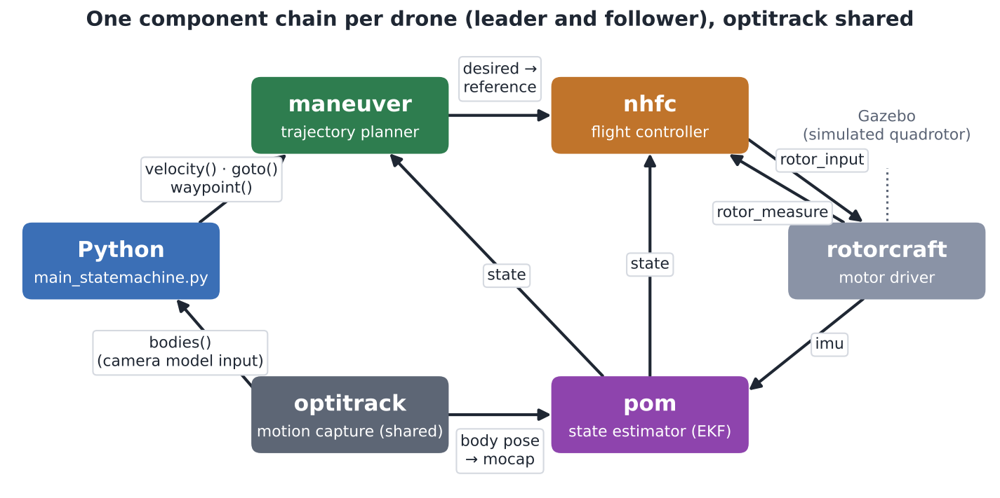
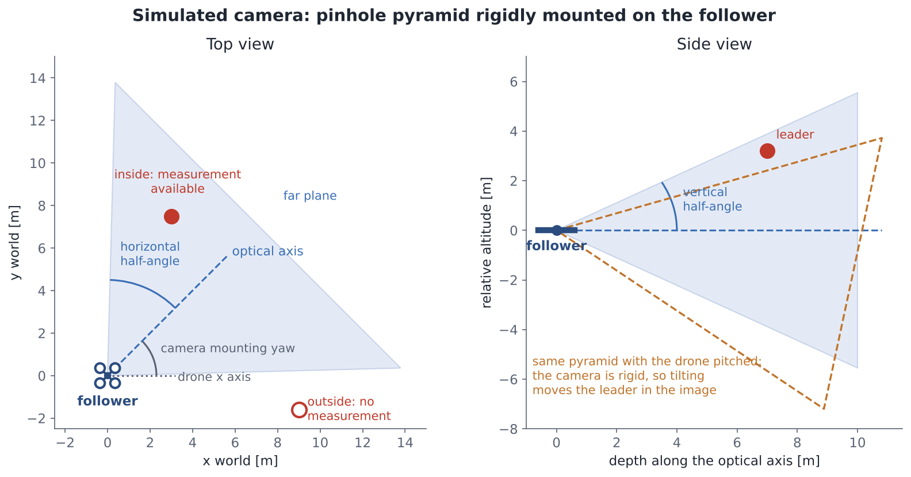
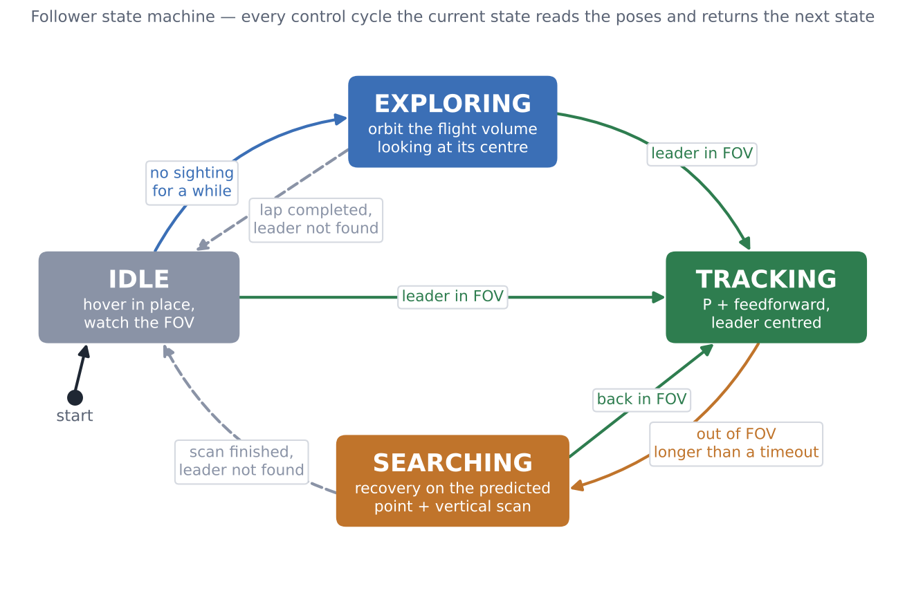
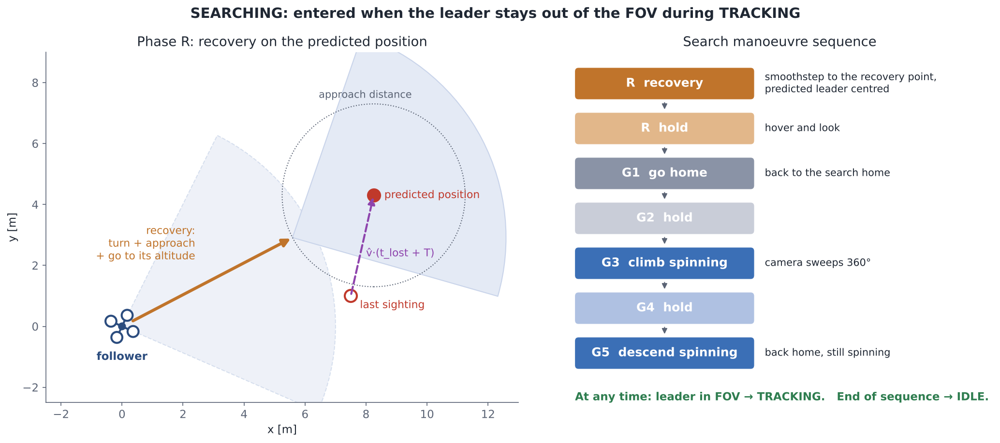
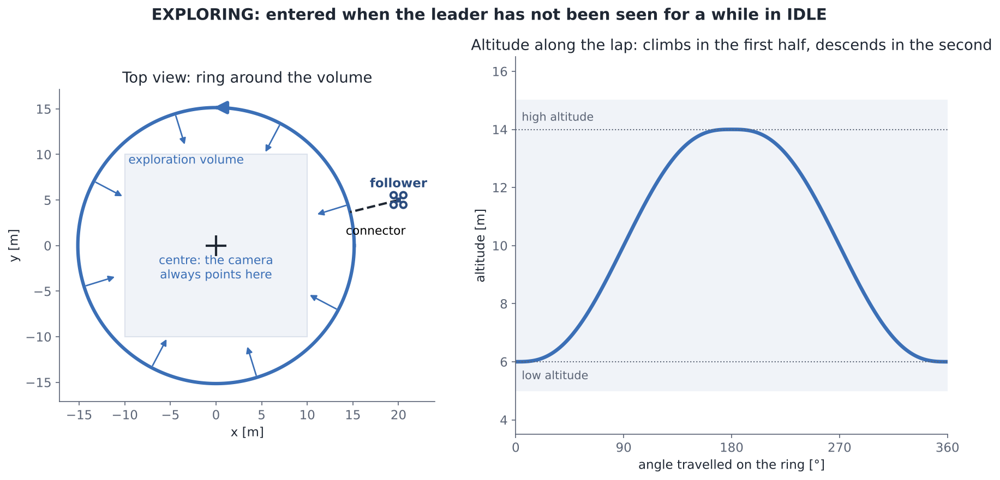
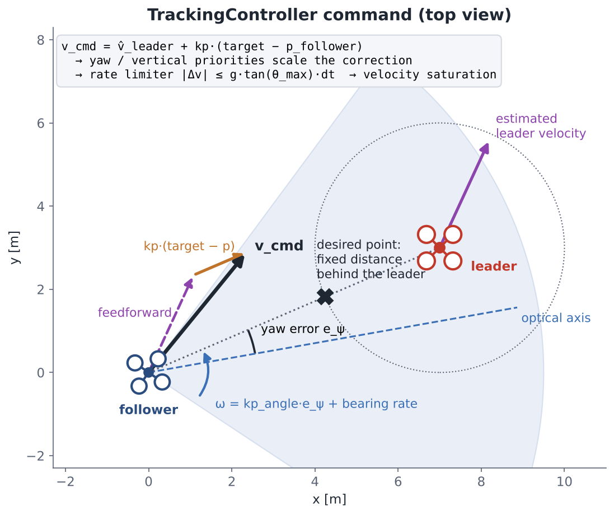
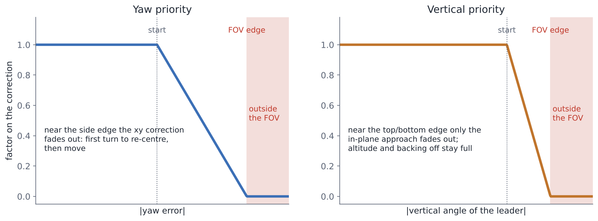
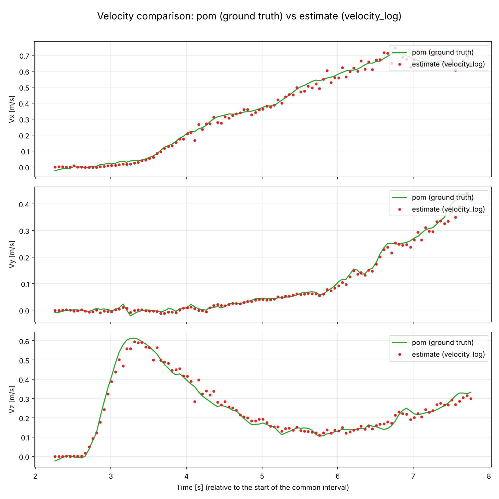

# Drone Chase — vision-only interception of a quadrotor

A chaser quadrotor (the **follower**) has to find, catch up with and keep in view a second quadrotor
(the **leader**) that flies a trajectory the follower does not know. The only information the follower
gets about the leader comes from a **simulated on-board camera**: if the leader is not inside the
camera field of view, the follower is blind.

Everything runs in a Gazebo simulation on top of the [telekyb3](https://git.openrobots.org/projects/telekyb3)
/ GenoM3 framework, driven by a single Python process through `python-genomix`.

The code lives in [`src/final_project/`](src/final_project). The other folders of the repository
(`src/01-intro`, `src/02c-model`, …) are earlier lab exercises of the course.

---

## How it works

### Architecture



Each drone has its own `rotorcraft → pom → nhfc → maneuver` chain; `optitrack` is shared.
Python only **sends commands to `maneuver`** and **reads poses from `optitrack`**; all the other data
flows directly between the GenoM3 components.

### The leader

The leader flies one of these trajectories, chosen with `leader_trajectory` in `config.py`:

- **random waypoints** — a sequence of random points (fixed by `random_seed`), queued once in the
  leader's planner at the start of the run; the leader flies each segment at its maneuver limits
  and stops on every waypoint;
- **figure-8** — a 3D lemniscate, pre-computed with an arc-length time law (smooth start, then
  constant cruise speed) and streamed to the planner sample by sample;
- **hover, straight line, circle, vertical step** — simple trajectories used by the benchmark,
  streamed the same way.

### The simulated camera



The camera is a pinhole **FOV pyramid** rigidly mounted on the follower (with a yaw offset w.r.t. the
drone x axis). At every cycle the leader's ground-truth position is transformed into the camera
frame; it counts as *seen* only if it lies inside the pyramid (depth range + horizontal and vertical
half-angles). Because the camera is rigid, roll and pitch of the follower move the leader in the
image just like on a real drone. The same parameters are copied into the Gazebo model, so the
rendered camera matches the one used by the controller.

The leader's velocity is estimated by numerical differentiation of the camera measurements
(transformed back to world frame), and is reset every time the leader re-enters the FOV.

### The state machine



| State | What the follower does |
|---|---|
| **IDLE** | Hovers and watches. Leader in view → TRACKING; nothing for a while → EXPLORING. |
| **EXPLORING** | Flies to a ring around the expected flight volume and circles it while climbing and descending, camera pointed at the centre. |
| **TRACKING** | Keeps the leader centred in the image (details below). If the leader leaves the FOV it keeps chasing the *predicted* position for a short grace period, then switches to SEARCHING. |
| **SEARCHING** | Plans a manoeuvre from the last estimate: a fast **recovery** towards where the leader should be now (turning to put it in the centre of the image), then a **global scan** (go home, climb and descend while spinning). |

All search and exploration segments use a 5th-order smoothstep time law whose duration is computed
from the velocity and acceleration limits, so every reference sent to the planner is feasible by
construction.





### The tracking controller

At every control cycle the follower receives a world-frame velocity and a yaw rate:



- **Position:** P control towards a point at a fixed horizontal distance *behind* the leader along
  the line of sight, at the leader's altitude, **plus full feedforward** of the estimated leader
  velocity.
- **Yaw:** P on the bearing error plus feedforward of the bearing rate, so the optical axis follows
  the leader instead of lagging behind.
- **Priorities:** when the leader drifts towards the side of the image, the horizontal correction
  is faded out and the drone turns first; when it drifts towards the top/bottom edge, the approach
  is faded out and only the altitude correction remains.
- **Tilt budget:** the command is rate-limited to an acceleration derived from a maximum tilt angle
  (`a = g·tan θ`), because with a rigid camera every degree of tilt shifts the leader by one degree
  in the image.
- **Bumpless transfer:** when entering TRACKING the rate limiter starts from the follower's
  *measured* velocity, so switching from exploring/searching causes no braking.



### Code map

| Path | Role |
|---|---|
| `main_statemachine.py` | Entry point: setup, takeoff, leader trajectory, 20 Hz loop, shutdown |
| `config.py` | **All** parameters and output paths — nothing is hard-coded elsewhere |
| `components/functions.py` | GenoM3 connection, component setup / start / stop, random waypoints |
| `components/camera.py` | `FOVPyramid` (camera model) and `TrackingController` |
| `components/velocity_estimator.py` | Leader velocity by numerical differentiation |
| `components/Research.py` | Smoothstep primitives and the search manoeuvre planner |
| `components/trajectory_handler.py` | Figure-8 trajectory of the leader |
| `components/leader_trajectories.py` | Hover, line, circle and vertical-step trajectories of the leader |
| `components/optitrack_helper.py` | Reading poses from `optitrack` |
| `state_machine/` | State machine core and the four states |
| `simulation/quad_simulation.sh` | Starts all GenoM3 components and Gazebo |
| `simulation/sync_camera_fov.py` | Copies camera FOV and follower spawn from `config.py` into the Gazebo files |
| `graphics/` | Plot scripts (trajectory, tracking analysis, velocity estimate) |
| `benchmark/` | Benchmark scenarios, batch runner and analysis (see `benchmark/README.md`) |

---

## Results

<!-- TODO: replace the placeholders with the final figures/videos -->

### Full chase (random leader, follower spawned far away)

> 📹 *Video / GIF of a full run in Gazebo: IDLE → EXPLORING → TRACKING → SEARCHING → TRACKING.*
>
> ``

### Tracking quality

> 📈 *Output of `graphics/tracking_plotter.py`: leader–follower distance, yaw error, vertical angle
> in the camera, top view with the out-of-FOV intervals highlighted.*
>
> ``

### Velocity estimation

The leader velocity estimated by differentiating the camera measurements (dots) against the `pom` state estimate (line):



### Search and recovery

> 🔍 *Top view of a run where the leader is lost and re-acquired, with the recovery point and the
> state timeline.*
>
> ``

---

## Installation

### 1. telekyb3 lab environment

The project runs inside the **tk3lab Docker image** (Ubuntu 24.04) provided with the course, which
already contains telekyb3, the GenoM3 components (`rotorcraft`, `pom`, `nhfc`, `maneuver`,
`optitrack`, PocoLibs middleware), `python-genomix` and Gazebo Sim.

1. Install Docker (Docker Engine on Linux; Docker Desktop or Colima on Apple-silicon macOS).
2. Download the image `dimg-X.Y` and the release `r-Z.W` from the course share and place them in
   `~/tk3lab/docker-images/` and `~/tk3lab/releases/`.
3. Load and run the image:
   ```sh
   cd ~/tk3lab/releases/r-Z.W
   sh scripts/tk3lab-load ~/tk3lab/docker-images/dimg-X.Y/tk3lab-ionic-X.Y.tar.gz
   sh scripts/tk3lab-run -g ionic -v X.Y
   ```
4. Open <http://127.0.0.1:6080> in a browser and click **Connect** to get the virtual desktop.

### 2. This repository

Inside the container, clone the repository as the persistent workspace `~/tk3lab-ws`
(the simulation script expects the Gazebo world at that path):

```sh
git clone https://github.com/chettante/tk3lab-ws.git ~/tk3lab-ws
```

Python dependencies besides `genomix`: `numpy` and `matplotlib`
(`pip install numpy matplotlib` if they are not already available).

---

## Usage

1. **Configure** the run in `src/final_project/config.py` (leader trajectory type and speed,
   follower spawn `near`/`far`, camera FOV, controller gains, …). Settings that affect Gazebo
   (camera, follower spawn) require restarting the simulation.

2. **Start the simulation** (terminal 1):
   ```sh
   cd ~/tk3lab-ws/src/final_project/simulation
   sh quad_simulation.sh
   ```
   This starts the GenoM3 components (two instances per drone), syncs the camera and spawn into the
   Gazebo files and opens Gazebo. If the simulation starts paused, press **Play**.

3. **Run the chase** (terminal 2):
   ```sh
   cd ~/tk3lab-ws/src/final_project
   python3 main_statemachine.py
   ```
   The drones take off, the leader starts its trajectory and the follower's state transitions are
   printed in the terminal. The run ends automatically (or with `Ctrl+C`); in both cases the motors
   are stopped and the follower path is saved under `graphics/plot/`.

4. **Analyse the run** (optional):
   ```sh
   cd ~/tk3lab-ws/src/final_project/graphics
   python3 tracking_plotter.py     # distance, yaw error, vertical angle, top view
   python3 velocity_plotter.py     # estimated vs true leader velocity
   ```
   Both scripts read their default input/output paths from `config.py`; the options are described
   at the top of each file (`tracking_plotter.py -h` lists them).

5. Stop the simulation with `Ctrl+C` in terminal 1 (this also kills the Gazebo server, freeing the
   OptiTrack port for the next run).

### Benchmark

`benchmark/run_benchmark.py` runs a whole campaign of scenarios unattended, starting and stopping
the simulation for each run (do not start it by hand), and `benchmark/analyze_benchmark.py` turns
the logs into a metrics table and comparison plots. See `src/final_project/benchmark/README.md`.

---

## Authors

Enrico Castelli ([@chettante](https://github.com/chettante)) and teammates — Aerial Robotics course project.
